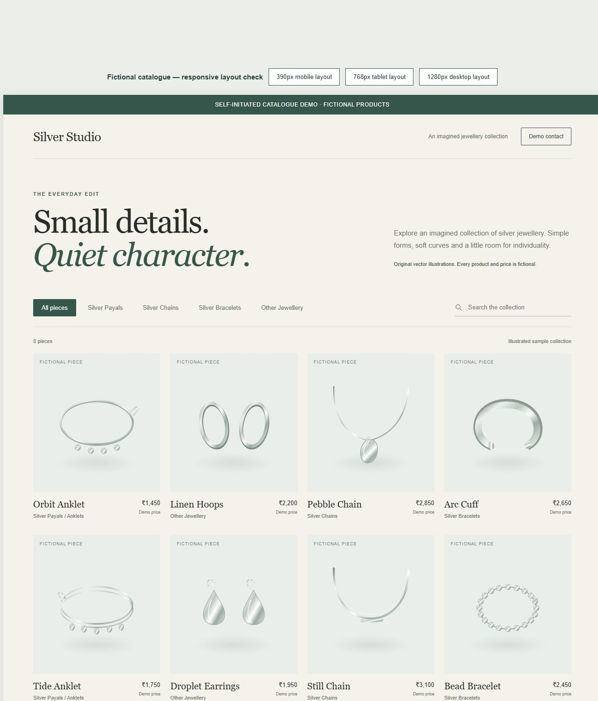
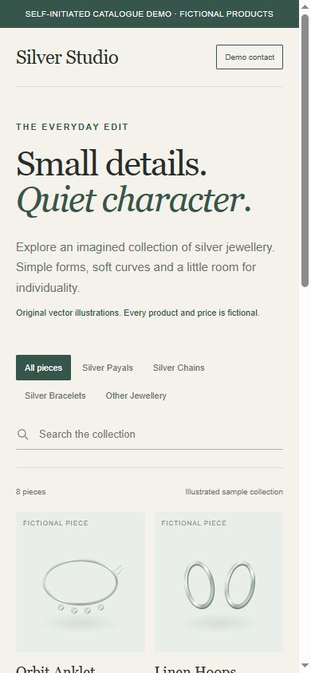

# Silver Studio catalogue demo

This is a small, original, self-initiated frontend sample. Silver Studio is a fictional brand. All eight products, illustrations and prices are fictional. It is not a client commission or a published store.

## Preview

Open `index.html` locally in a modern browser. The page is self-contained and uses no dependencies, external assets, network APIs or tracking. Text and product data can be edited in the file.

The sample includes:

- A responsive catalogue for silver payals (anklets), silver chains, silver bracelets and other jewellery.
- Eight original inline SVG illustrations.
- Category filtering and case-insensitive search by product name or category. Both filters work together.
- A live result count and a reset control when no results match.
- A clearly marked demo contact dialog. It collects no details and sends no enquiry.

Filter state exists only in memory and resets on reload. There is no checkout, payment flow, real contact information, customer data storage or backend.

CMS setup, editing real product images, hosting, deployment and connecting a real enquiry channel would be separate agreed scope. This sample does not claim previous work for any client.

## Verification

The layout was reviewed in Chrome with embedded CSS viewports at 390px, 768px and 1280px. None had horizontal overflow. Category filtering (2 payals), combined category/search (1 Orbit Anklet), no matches (0), reset (8), and opening/closing the demo contact dialog were checked through the visible UI. Mobile category controls were also checked.

The previews are layout checks, not tests on physical phones or a cross-browser compatibility guarantee. `responsive-check.html` provides the same three local preview widths. Details are in `verification.json`.
